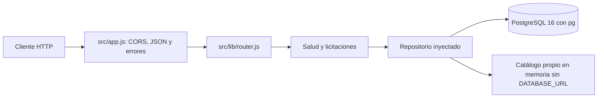

# Arquitectura — LicitacionesUV Backend

`src/server.js` selecciona PostgreSQL cuando hay `DATABASE_URL`; sin ella deja
que `createApp` use el catálogo local. El pool se cierra al detener el servidor.
El arranque no ejecuta migraciones ni seed. Las rutas dependen de una interfaz
asíncrona `list` y `findById`, no del motor concreto.

`src/db/pool.js` concentra la carga del driver y la conexión. Las consultas SQL
usan parámetros `$1`, `$2`, etc. La búsqueda `ILIKE` escapa comodines y solo consulta
el título. La fecha se convierte en SQL a `YYYY-MM-DD`, evitando desplazamientos
por zona horaria. El monto BIGINT pasa a número en el contrato HTTP.

Se mantienen `/api/health`, `/api/licitaciones` y `/api/licitaciones/:id`, CORS y
los errores JSON. Los fallos internos responden 500 genérico; no se exponen detalles
al cliente. El contrato público conserva nueve campos.

La línea activa `migrations/postgresql/` crea las ocho entidades y regiones.
Cada archivo y su registro comparten una transacción. El seed usa un catálogo
propio y hace upsert por identificador. Las líneas SQLite y PostgreSQL histórica
se conservan archivadas, sin ejecutarse ni convertir datos automáticamente.

PostgreSQL fue elegido para la operación compartida y la futura importación de
Mercado Público. Esta elección no implementa el consumo de esa API ni requiere
cambiar ahora el contrato del frontend. El cliente React conserva su mock local.

CI instala PostgreSQL 16 directamente en Ubuntu 24.04 y usa una base de pruebas propia. Las pruebas crean esquemas aislados en una base
cuyo nombre termina en `_test`. Autenticación, favoritos y aprobaciones conservan
sus tablas, pero todavía no tienen endpoints de escritura ni sesiones.
