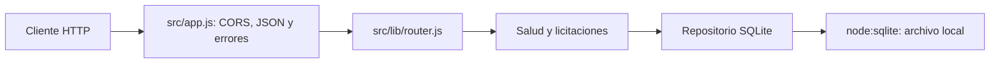

# Arquitectura — LicitacionesUV Backend

`src/server.js` abre SQLite, aplica la línea de migraciones activa y compone la API
con `createSqliteLicitacionesRepository`. Cierra la conexión al detener el servidor.
`createApp` admite inyectar un repositorio; su opción en memoria se utiliza para
pruebas aisladas del enrutamiento, no como selección de motor en producción.

`src/db/connection.js` administra el archivo, claves foráneas, WAL, espera de bloqueos
y la función determinista `lower_unicode`. Las consultas enlazan valores con `?`.
`instr` realiza búsqueda literal por título y evita interpretar comodines. Las
fechas se almacenan como texto ISO y se devuelven sin conversión de zona horaria.

Los endpoints mantienen `/api/health`, `/api/licitaciones` y `/api/licitaciones/:id`.
Los errores de entrada devuelven 400, 404 o 413; los fallos internos responden 500
con mensaje genérico. El contrato público conserva los nueve campos documentados.

Las ocho entidades están en `migrations/sqlite/`. El migrador aplica cada archivo
y su registro en una transacción; el seed es idempotente por identificador. La
línea histórica `migrations/legacy-postgresql/` se conserva sin ejecutarse.

El backend requiere Node >= 22.22.0. CI, pruebas e integración usan SQLite sin
servicios externos. El cliente React vive en otro repositorio y conserva su mock.
Autenticación, favoritos y aprobaciones no tienen endpoints implementados todavía.
